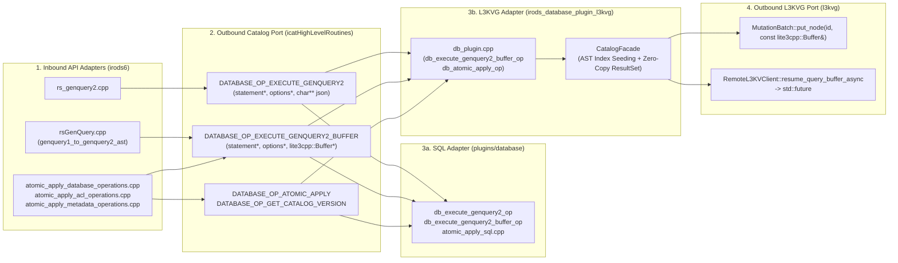

# Hexagonal Architecture & End-to-End `lite3cpp::Buffer` Pipeline Implementation Plan

> **For agentic workers:** REQUIRED SUB-SKILL: Use superpowers:subagent-driven-development (recommended) or superpowers:executing-plans to implement this plan task-by-task. Steps use checkbox (`- [ ]`) syntax for tracking.

**Goal:** Unify the Hexagonal Architecture (Ports and Adapters) across `irods` (`irods6`), `irods_database_plugin_l3kvg`, and `l3kvg` around typed GenQuery2/DML ASTs and zero-copy `lite3cpp::Buffer` transport—closing all three identified boundary leaks, eliminating `nanodbc` bypasses in core and API plugins, retiring all legacy GenQuery1 bridge code and redundant headers, and eliminating intermediate string allocations.

**Architecture:**
1. **Close All 3 Hexagonal Boundary Leaks on `irods6` Core & API Plugins**:
   - **Leak 1 (GenQuery2 AST Dispatch)**: Port `DATABASE_OP_EXECUTE_GENQUERY2` (`chl_execute_genquery2`) and introduce `DATABASE_OP_EXECUTE_GENQUERY2_BUFFER` (`chl_execute_genquery2_buffer`), routing both `rs_genquery2.cpp` and `rsGenQuery.cpp` through the AST port so core never invokes `to_sql()` for query execution.
   - **Leak 2 (Direct `nanodbc` Bypasses in Core & API Plugins)**:
     - Move the 1,100-line `nanodbc` implementation out of `server/core/src/atomic_apply_database_operations.cpp` into `plugins/database/src/atomic_apply_sql.cpp` behind `DATABASE_OP_ATOMIC_APPLY`, and wire `DATABASE_OP_ATOMIC_APPLY` in `irods_database_plugin_l3kvg` directly to `CatalogFacade::atomic_apply_operations`.
     - Replace direct `nanodbc` calls in `server/main_server/src/main.cpp` (`check_catalog_schema_version`, `wait_for_external_dependent_servers_to_start`, `init_access_time_queue`) with database plugin port calls (`DATABASE_OP_GET_CATALOG_VERSION`, `chlOpen`/`chlClose`, `chl_get_grid_configuration_value`).
     - Decouple `server/core/src/catalog_utilities.cpp`, `plugins/api/src/atomic_apply_acl_operations.cpp`, and `plugins/api/src/atomic_apply_metadata_operations.cpp` from `nanodbc` by routing permission checks and ACL/AVU mutations through the Catalog Port (`chl_execute_genquery2_buffer`, `chlModAccessControl`, `chlAddAVUMetadata`, `chlDeleteAVUMetadata`).
   - **Leak 3 (Port Payload Impedance Mismatch & Raw `char**` Allocations)**:
     - Exchange `lite3cpp::Buffer` directly via `DATABASE_OP_EXECUTE_GENQUERY2_BUFFER` + `rows_buffer_to_genquery_out`, eliminating `std::stringstream` JSON serialization, `strdup` `char**` allocations, and `nlohmann::json::parse` on the GenQuery path.
2. **Outbound Storage Client Port (`l3kvg`)**:
   - Extend `l3kvg::MutationBatch::put_node` and `l3kvg::RemoteL3KVClient::put_node_async` to accept `const lite3cpp::Buffer&` directly without intermediate `std::string` allocations (`Buffer::move_to_string()`).
   - Add `l3kvg::RemoteL3KVClient::resume_query_buffer_async(...) -> std::future<lite3cpp::Buffer>` and `get_node_buffer_async(...) -> std::future<lite3cpp::Buffer>`.
3. **Catalog Domain & Adapter Cleanup (`irods_database_plugin_l3kvg`)**:
   - Back `irods::catalog::ResultSet` directly with `lite3cpp::Buffer` + row offsets (`bind_buffer(lite3cpp::Buffer&&)`) so `get_field(row, col)` and `get_field(row, key)` return `std::string_view` slices in $O(1)$ without allocating `std::unordered_map<std::string, std::string>` per row.
   - Eliminate all `buf.move_to_string()` heap allocations across `src/catalog/catalog_facade.cpp`.
   - Move AST-driven index `starting_nodes` resolution and column value normalization directly into `CatalogFacade::execute_query(const genquery2::select&, ...)` and retire `src/gq1_bridge.cpp`, `db_gen_query_op`, and unused headers (`data_plane_client.hpp`, `federation_resolver.hpp`, `l3kvg_mapper.hpp`, `catalog_schemas.hpp`).

**Tech Stack:** C++20, `lite3-cpp` (`lite3cpp::Buffer`), iRODS 6.0 Plugin Architecture, L3KVG RPC & `MutationBatch`, Catch2, GoogleTest.

---

## Target Hexagonal Architecture (Ports & Adapters)



---

## Task 1: Unify Hexagonal Catalog Port (`DATABASE_OP_EXECUTE_GENQUERY2`, `DATABASE_OP_EXECUTE_GENQUERY2_BUFFER`) & Eliminate `nanodbc` Boundary Leaks on `irods6`

**Files (in `/home/darkfell/dev/irods`):**
- Modify: `lib/core/include/irods/irods_plugin_base.hpp`
- Modify: `server/core/include/irods/irods_database_constants.hpp`
- Modify: `server/icat/include/irods/icatHighLevelRoutines.hpp`
- Modify: `server/icat/src/icatHighLevelRoutines.cpp`
- Modify: `lib/core/include/irods/genquery2_builder.hpp`
- Create: `plugins/database/include/irods/private/atomic_apply_sql.hpp`
- Create: `plugins/database/src/atomic_apply_sql.cpp`
- Modify: `plugins/database/CMakeLists.txt`
- Modify: `plugins/database/src/db_plugin.cpp`
- Modify: `server/core/src/atomic_apply_database_operations.cpp`
- Modify: `server/core/include/irods/catalog.hpp`
- Modify: `server/core/src/catalog.cpp`
- Modify: `server/core/include/irods/catalog_utilities.hpp`
- Modify: `server/core/src/catalog_utilities.cpp`
- Modify: `plugins/api/src/atomic_apply_acl_operations.cpp`
- Modify: `plugins/api/src/atomic_apply_metadata_operations.cpp`
- Modify: `server/api/src/rs_genquery2.cpp`
- Modify: `server/api/src/rsGenQuery.cpp`
- Modify: `server/main_server/src/main.cpp`
- Create: `unit_tests/src/test_genquery2_ast_dispatch.cpp`
- Create: `unit_tests/cmake/test_config/irods_genquery2_ast_dispatch.cmake`
- Modify: `unit_tests/CMakeLists.txt`

- [ ] **Step 1: Extend `PluginParam`, `irods_database_constants.hpp`, and `icatHighLevelRoutines` with AST, `lite3cpp::Buffer`, and Atomic Apply catalog operations**

1. In [`lib/core/include/irods/irods_plugin_base.hpp`](file:///home/darkfell/dev/irods/lib/core/include/irods/irods_plugin_base.hpp):
   - Forward-declare `namespace irods::experimental::genquery2 { struct statement; struct options; }` and `namespace lite3cpp { class Buffer; }`.
   - Add `const irods::experimental::genquery2::statement*`, `const irods::experimental::genquery2::options*`, and `lite3cpp::Buffer*` to `PluginParam`.
2. In [`server/core/include/irods/irods_database_constants.hpp`](file:///home/darkfell/dev/irods/server/core/include/irods/irods_database_constants.hpp):
   - Add:
     ```cpp
     inline constexpr const char* DATABASE_OP_EXECUTE_GENQUERY2        = "db_execute_genquery2_op";
     inline constexpr const char* DATABASE_OP_EXECUTE_GENQUERY2_BUFFER = "db_execute_genquery2_buffer_op";
     inline constexpr const char* DATABASE_OP_GET_CATALOG_VERSION      = "database_get_catalog_version";
     inline constexpr const char* DATABASE_OP_INITIALIZE_CATALOG       = "database_initialize_catalog";
     inline constexpr const char* DATABASE_OP_ATOMIC_APPLY             = "database_atomic_apply";
     ```
3. In [`server/icat/include/irods/icatHighLevelRoutines.hpp`](file:///home/darkfell/dev/irods/server/icat/include/irods/icatHighLevelRoutines.hpp) and [`server/icat/src/icatHighLevelRoutines.cpp`](file:///home/darkfell/dev/irods/server/icat/src/icatHighLevelRoutines.cpp):
   - Declare and implement:
     - `chl_execute_genquery2(RsComm&, const irods::experimental::genquery2::statement&, const irods::experimental::genquery2::options&, char**) noexcept`
     - `chl_execute_genquery2_buffer(RsComm&, const irods::experimental::genquery2::statement&, const irods::experimental::genquery2::options&, lite3cpp::Buffer&) noexcept`
     - `chl_get_catalog_version(RsComm&, int&) noexcept`
     - `chl_atomic_apply(RsComm&, const char* _json_input) noexcept`

- [ ] **Step 2: Add `rows_buffer_to_genquery_out` to `genquery2_builder.hpp` and route `rs_genquery2.cpp` and `rsGenQuery.cpp` through the AST ports (Closing Leak 1 & Leak 3)**

1. In [`lib/core/include/irods/genquery2_builder.hpp`](file:///home/darkfell/dev/irods/lib/core/include/irods/genquery2_builder.hpp):
   - Include `"buffer.hpp"` (`lite3-cpp`).
   - Add `rows_buffer_get_row_count(const lite3cpp::Buffer& _rows_buf) -> std::size_t` and `rows_buffer_to_genquery_out(const lite3cpp::Buffer& _rows_buf, std::span<const int> _column_ids, genQueryOut_t*& _out, std::size_t _max_rows = MAX_SQL_ROWS) -> int` reading zero-copy `std::string_view` slices directly from the top-level `lite3cpp::Type::Array` (`{"proj": [...]}` or `[...]`).
2. In [`server/api/src/rs_genquery2.cpp`](file:///home/darkfell/dev/irods/server/api/src/rs_genquery2.cpp):
   - Dispatch AST and options via `chl_execute_genquery2(*_comm, ast, opts, &sql_rows)`.
3. In [`server/api/src/rsGenQuery.cpp`](file:///home/darkfell/dev/irods/server/api/src/rsGenQuery.cpp):
   - Dispatch AST and options via `chl_execute_genquery2_buffer(*rsComm, stmt, opts, rows_buf)` and populate `*genQueryOut` via `rows_buffer_to_genquery_out(rows_buf, std::span<const int>{col_ids}, *genQueryOut, max_rows)` (falling back to `chl_execute_genquery2` if a custom plugin only registers JSON output).

- [ ] **Step 3: Move `nanodbc` out of `atomic_apply_database_operations.cpp`, `main.cpp`, `catalog_utilities.cpp`, `atomic_apply_acl_operations.cpp`, and `atomic_apply_metadata_operations.cpp` (Closing Leak 2)**

1. **Core DML (`atomic_apply_database_operations.cpp` -> `plugins/database/src/atomic_apply_sql.cpp`)**:
   - Move the `nanodbc` SQL implementation from `server/core/src/atomic_apply_database_operations.cpp` into `plugins/database/src/atomic_apply_sql.cpp` and register `DATABASE_OP_ATOMIC_APPLY` (`db_atomic_apply_op`), `DATABASE_OP_GET_CATALOG_VERSION` (`db_get_catalog_version_op`), `DATABASE_OP_EXECUTE_GENQUERY2` (`db_execute_genquery2_op`), and `DATABASE_OP_EXECUTE_GENQUERY2_BUFFER` (`db_execute_genquery2_buffer_op`) in [`plugins/database/src/db_plugin.cpp`](file:///home/darkfell/dev/irods/plugins/database/src/db_plugin.cpp).
   - Update [`server/core/src/atomic_apply_database_operations.cpp`](file:///home/darkfell/dev/irods/server/core/src/atomic_apply_database_operations.cpp) so `apply_database_operations` serializes the DML operations and dispatches to `chl_atomic_apply(*_comm, json_str.c_str())` with zero `nanodbc` dependency in core.
2. **Server Startup (`server/main_server/src/main.cpp` & `server/core/src/catalog.cpp`)**:
   - Update `check_catalog_schema_version()`, `wait_for_external_dependent_servers_to_start()`, and `init_access_time_queue()` in [`server/main_server/src/main.cpp`](file:///home/darkfell/dev/irods/server/main_server/src/main.cpp) to use `chl_get_catalog_version`, `connected_to_catalog` (`chlOpen`/`chlClose`), and `chl_get_grid_configuration_value` (with safe defaults when not configured) so `main.cpp` never calls `nanodbc::execute` directly.
3. **Catalog Utilities & Atomic Apply ACL/Metadata Plugins (`catalog_utilities.cpp`, `atomic_apply_acl_operations.cpp`, `atomic_apply_metadata_operations.cpp`)**:
   - In [`server/core/src/catalog_utilities.cpp`](file:///home/darkfell/dev/irods/server/core/src/catalog_utilities.cpp), add database-agnostic overloads `user_has_permission_to_modify_entity(RsComm& _comm, std::int64_t _object_id, const entity_type _entity_type) -> bool` and `user_has_permission_to_modify_acls(RsComm& _comm, std::int64_t _object_id) -> bool` using `chl_execute_genquery2_buffer` (or `catalog::access_control`), so callers do not need a `nanodbc::connection`.
   - In [`plugins/api/src/atomic_apply_acl_operations.cpp`](file:///home/darkfell/dev/irods/plugins/api/src/atomic_apply_acl_operations.cpp) and [`plugins/api/src/atomic_apply_metadata_operations.cpp`](file:///home/darkfell/dev/irods/plugins/api/src/atomic_apply_metadata_operations.cpp), route `get_object_id`, permission checks, and ACL/metadata operations through `chl_execute_genquery2_buffer` and the catalog plugin (`chlModAccessControl` / `chlAddAVUMetadata` / `chlDeleteAVUMetadata`) when `database_type == "l3kvg"` (or universally via the catalog plugin port) so both plugins work without `nanodbc::connection`.

- [ ] **Step 4: Add Catch2 unit tests in `unit_tests/src/test_genquery2_ast_dispatch.cpp`, run `scripts/verify_refactoring.sh`, and commit**

1. Create `unit_tests/src/test_genquery2_ast_dispatch.cpp` and `unit_tests/cmake/test_config/irods_genquery2_ast_dispatch.cmake`.
2. Build, run `irods_genquery2_ast_dispatch`, run `/home/darkfell/dev/irods/scripts/verify_refactoring.sh`, commit on `irods6` (`git commit --no-verify`), and push to `fork/irods6`.

---

## Task 2: `lite3cpp::Buffer`-Native `MutationBatch` & `RemoteL3KVClient` in `l3kvg`

**Files (in `/home/darkfell/dev/l3kvg`):**
- Modify: `include/L3KVG/MutationBatch.hpp`
- Modify: `src/MutationBatch.cpp`
- Modify: `include/L3KVG/RemoteL3KVClient.hpp`
- Modify: `src/RemoteL3KVClient.cpp`

- [ ] **Step 1: Add `const lite3cpp::Buffer&` overload to `MutationBatch::put_node`**

1. In [`include/L3KVG/MutationBatch.hpp`](file:///home/darkfell/dev/l3kvg/include/L3KVG/MutationBatch.hpp) and [`src/MutationBatch.cpp`](file:///home/darkfell/dev/l3kvg/src/MutationBatch.cpp):
   - Add `void put_node(uint64_t node_id, const lite3cpp::Buffer& payload)` passing `std::string_view(reinterpret_cast<const char*>(payload.data()), payload.size())` directly to `put_node(node_id, std::string_view)`.

- [ ] **Step 2: Add `put_node_async(const lite3cpp::Buffer&)`, `get_node_buffer_async`, and `resume_query_buffer_async` to `RemoteL3KVClient`**

1. In [`include/L3KVG/RemoteL3KVClient.hpp`](file:///home/darkfell/dev/l3kvg/include/L3KVG/RemoteL3KVClient.hpp) and [`src/RemoteL3KVClient.cpp`](file:///home/darkfell/dev/l3kvg/src/RemoteL3KVClient.cpp):
   - Add `put_node_async(lite3::NodeID, uint64_t, const lite3cpp::Buffer&, uint32_t)`, `get_node_buffer_async(...) -> std::future<lite3cpp::Buffer>`, and `resume_query_buffer_async(...) -> std::future<lite3cpp::Buffer>`.
   - Refactor `resume_query_async` to call `resume_query_buffer_async` internally so there is zero duplicate RPC code.

---

## Task 3: Zero-Copy `lite3cpp::Buffer`-Backed `ResultSet` & Zero-Allocation `MutationBatch` Writes in `irods_database_plugin_l3kvg`

**Files (in `/home/darkfell/dev/irods_database_plugin_l3kvg`):**
- Modify: `include/irods/catalog/catalog_facade.hpp`
- Modify: `src/catalog/catalog_facade.cpp`

- [ ] **Step 1: Upgrade `irods::catalog::ResultSet` to a zero-copy `lite3cpp::Buffer`-backed view**

1. In [`include/irods/catalog/catalog_facade.hpp`](file:///home/darkfell/dev/irods_database_plugin_l3kvg/include/irods/catalog/catalog_facade.hpp):
   - Extend `ResultSet` with `lite3cpp::Buffer raw_buffer` and `std::vector<size_t> row_offsets`, plus `bind_buffer(lite3cpp::Buffer&& buf)`.
   - Update `row_count()`, `empty()`, `get_field(size_t row_idx, size_t col_idx)`, and `get_field(size_t row_idx, std::string_view key)` to read zero-copy `std::string_view` slices directly from `raw_buffer` at `row_offsets[row_idx]`.

- [ ] **Step 2: Switch `CatalogFacade::execute_query` to `resume_query_buffer_async` and eliminate all `buf.move_to_string()` calls**

1. In [`src/catalog/catalog_facade.cpp`](file:///home/darkfell/dev/irods_database_plugin_l3kvg/src/catalog/catalog_facade.cpp):
   - Use `client_->resume_query_buffer_async(...)` and `results.bind_buffer(std::move(resp_buf))` in `CatalogFacade::execute_query`.
   - Replace every `buf.move_to_string()` call across `src/catalog/catalog_facade.cpp` with direct `const lite3cpp::Buffer&` writes.

---

## Task 4: Move AST Index Starting-Node Resolution into `CatalogFacade::execute_query` & Retire `gq1_bridge.cpp` and Redundant Headers

**Files (in `/home/darkfell/dev/irods_database_plugin_l3kvg`):**
- Delete: `include/irods/catalog/data_plane_client.hpp`
- Delete: `include/irods/catalog/federation_resolver.hpp`
- Delete: `include/irods/catalog/l3kvg_mapper.hpp`
- Delete: `include/irods/catalog/catalog_schemas.hpp`
- Delete: `src/gq1_bridge.cpp`
- Modify: `src/catalog/catalog_facade.cpp`
- Modify: `src/db_plugin.cpp`
- Modify: `CMakeLists.txt`
- Modify: `tests/test_gq1_bridge.cpp`
- Modify: `tests/test_repro_imkdir.cpp`
- Modify: `tests/test_repro_icp.cpp`

- [ ] **Step 1: Delete the 4 unused overlapping headers and remove their includes**

1. `git rm` `data_plane_client.hpp`, `federation_resolver.hpp`, `l3kvg_mapper.hpp`, and `catalog_schemas.hpp`, and remove their `#include` lines from `src/catalog/catalog_facade.cpp`.

- [ ] **Step 2: Integrate AST-driven index `starting_nodes` resolution, ticket restriction handling, and column normalization into `CatalogFacade::execute_query`**

1. In [`src/catalog/catalog_facade.cpp`](file:///home/darkfell/dev/irods_database_plugin_l3kvg/src/catalog/catalog_facade.cpp):
   - Add AST condition extraction on `const irods::experimental::genquery2::select& ast` to seed `starting_nodes` from L3KVG secondary indexes (`idx:data_path`, `idx:avu`, `DATA_ID`, `COLL_ID`, `idx:coll_path` including `IN` list expansion for `parent_of`, `idx:user_name`, `idx:resc_name`, `idx:rule_id`, `idx:ticket_str`, `idx:zone_name`, `idx:type`), handle `TICKET_ALLOWED_*` queries, and normalize access permission / expiry / inheritance column values.

- [ ] **Step 3: Retire `src/gq1_bridge.cpp` and `db_gen_query_op`, and update plugin tests**

1. `git rm src/gq1_bridge.cpp` and remove it from `CMakeLists.txt`.
2. Remove `db_gen_query_op`, `db_gen_query_access_control_setup_op`, and `db_gen_query_ticket_setup_op` from `src/db_plugin.cpp`.
3. Update `tests/test_gq1_bridge.cpp`, `tests/test_repro_imkdir.cpp`, and `tests/test_repro_icp.cpp` to translate `genQueryInp_t` via `irods::experimental::genquery2::genquery1_to_genquery2_ast` + `CatalogFacade::execute_query`.

---

## Task 5: Implement `DATABASE_OP_EXECUTE_GENQUERY2_BUFFER`, `DATABASE_OP_ATOMIC_APPLY`, & `DATABASE_OP_GET_CATALOG_VERSION` in `irods_database_plugin_l3kvg` & Run Full Verification

**Files (in `/home/darkfell/dev/irods_database_plugin_l3kvg`):**
- Modify: `src/db_plugin.cpp`

- [ ] **Step 1: Implement `db_execute_genquery2_buffer_op`, `db_atomic_apply_op`, and `db_get_catalog_version_op` in `src/db_plugin.cpp`**

1. In [`src/db_plugin.cpp`](file:///home/darkfell/dev/irods_database_plugin_l3kvg/src/db_plugin.cpp):
   - Implement `db_execute_genquery2_buffer_op` (`DATABASE_OP_EXECUTE_GENQUERY2_BUFFER`) returning `lite3cpp::Buffer` directly without `std::stringstream` JSON serialization, and refactor `db_execute_genquery2_op` (`char**`) to delegate to `db_execute_genquery2_buffer_op`.
   - Implement `db_atomic_apply_op` (`DATABASE_OP_ATOMIC_APPLY`, delegating to `g_facade->atomic_apply_operations(ops)`), `db_get_catalog_version_op` (`DATABASE_OP_GET_CATALOG_VERSION`), and `db_initialize_catalog_op` (`DATABASE_OP_INITIALIZE_CATALOG`), and register all operations in `l3kvg_database_plugin`.

- [ ] **Step 2: Build and run all unit and integration tests across `l3kvg`, `irods_database_plugin_l3kvg`, and `irods`**

1. Build and run all test targets in `/home/darkfell/dev/irods_database_plugin_l3kvg/build` (`ctest --output-on-failure`).
2. Verify `/home/darkfell/dev/irods/scripts/verify_refactoring.sh` passes all 4 dialectic stages.
3. Commit changes in `l3kvg`, `irods_database_plugin_l3kvg`, and `irods` (`irods6`) and push to remote.
